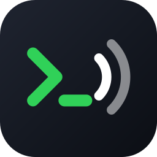
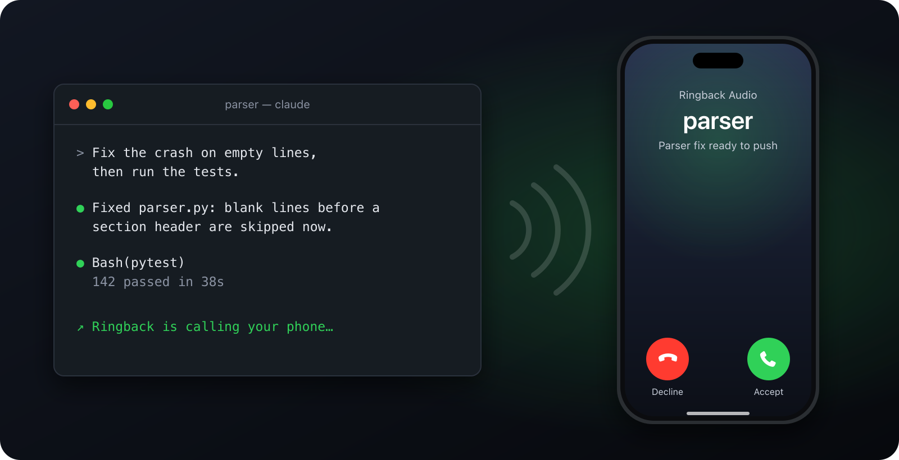
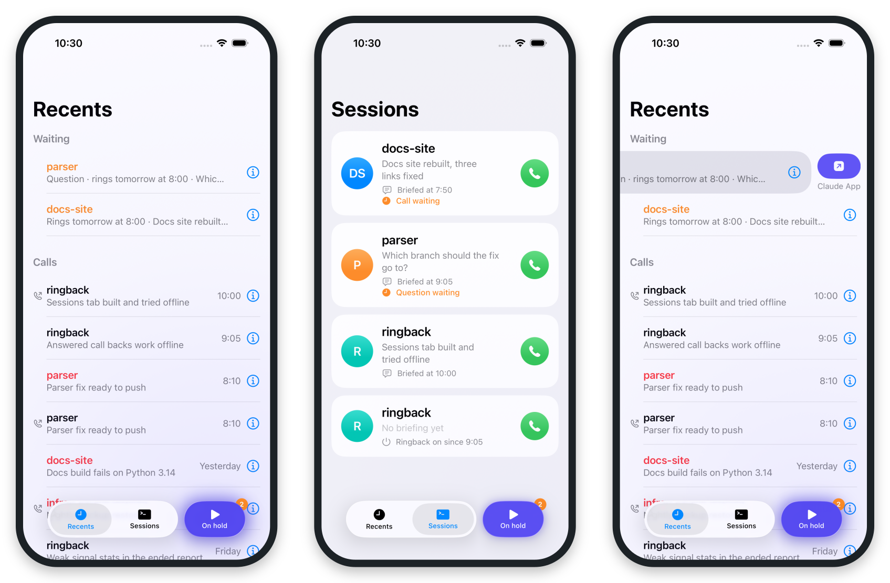
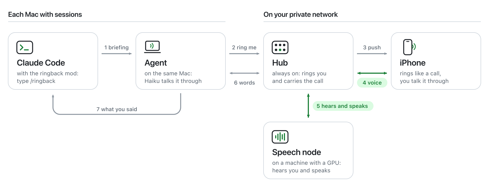

<p align="center">
  
</p>

<h1 align="center">Ringback</h1>

<p align="center">
  <b>Your Claude Code sessions call you back.</b><br>
  When a session finishes or needs you, your iPhone rings. Talk it through, hands-free,<br>
  and it gets back to work.
</p>

<p align="center">
  <a href="#how-it-works">How it works</a> ·
  <a href="#get-started">Get started</a> ·
  <a href="docs/setup.md">Setup guide</a> ·
  <a href="docs/design.md">Design</a>
</p>

<p align="center">
  
  
  
  
</p>

<p align="center">
  
</p>

Leave a long task running and walk away. When it's done, the session calls your phone, a
voice tells you what happened, and you answer the way you'd answer a colleague: *"Push it and
open a pull request."* Your words reach the session, it carries on, and if there's more to
decide, it calls again.

Ringback runs on your own machines and phone, over a private network of yours such as
[Nebula](https://github.com/slackhq/nebula). The voice is Claude Haiku through Claude Code, on
your Claude subscription, and the speech models run on your own GPU: no API key, and no server
of ours in between.

## What a call is like

- **It rings like a phone call.** Locked phone, headphones in, through CallKit. The voice is
  ready the moment you answer.
- **You can interrupt.** Start talking and the voice stops, the way a person would. It answers
  you in a second or two.
- **You say what's next.** "Run the tests again", "what did you change in the parser?". It
  passes instructions on, answers from the briefing, and tells you when the session replies.
- **You approve by voice.** A permission prompt or a question from the session comes to the
  call. A clear yes or no, or one of its options, answers it in the terminal.
- **It keeps your hours.** Outside your work hours, or while you've paused calls, calls wait in
  the app and ring when you're back. A question can go to the Claude app instead.
- **You can call back.** Every session with ringback on is one tap away, and so are your recent
  calls. Ask for a better model and Opus takes over the call.

## The app

<p align="center">
  <picture>
    <source media="(prefers-color-scheme: dark)" srcset="docs/images/screens-dark.png">
    
  </picture>
</p>

<p align="center"><sub>Recents, with calls on hold &nbsp;·&nbsp; Sessions, a tap to call each one &nbsp;·&nbsp; a waiting question, sent to the Claude app</sub></p>

Built like the Phone app, with one switch of its own: the pill beside the tabs holds every call
until you let them through, and breathes while it does. It's in Control Center too, and the
app's icon counts the calls that wait. When something calls need is down (your hub, the speech
computer, Apple's push), a banner at the top says what, in plain words, and goes once it's back.

## How it works

<p align="center">
  <picture>
    <source media="(prefers-color-scheme: dark)" srcset="docs/images/how-it-works-dark.png">
    
  </picture>
</p>

A small **mod** in each Claude Code session writes a spoken briefing when a turn ends, and hands
it to the **agent** on that Mac. The agent asks the **hub**, a small always-on service, to ring
your **iPhone**. When you answer, your voice goes to the hub, which passes it to the **speech
node**, a machine with a GPU: Silero hears when you speak, Smart Turn when you've finished, and
Parakeet what you said. Your words go to the agent, where Claude Haiku answers through Claude Code,
on the session's own Mac, and Kokoro, back on the speech node, speaks the answer. What you ask for
goes back to the session, and its answer comes back to the call.

The Macs and the speech node only ever dial out to the hub, and the phone reaches only the hub.
Between calls the speech node lets go of the GPU and its memory; it loads its models while your
phone rings.

The reasoning behind each part, and what every test on the phone showed, are in
[docs/design.md](docs/design.md).

## Get started

You need:

- an always-on Mac for the hub, Intel or Apple silicon (it needs nothing installed);
- a Linux machine with an NVIDIA GPU for the speech node: 3–3.5 GB of GPU memory and 3 GB of RAM
  during calls, next to nothing between them, and 4 GB on disk;
- Claude Code on each Mac that runs sessions, on a Claude subscription that includes Opus;
- a Mac with Xcode and Go, to build the app, the hub and the agent;
- an iPhone on iOS 26 or later, and a paid Apple Developer account, for VoIP pushes;
- a private network all of them reach, the phone too on mobile data: Nebula, with a lighthouse
  that relays, is the one it's tested on.

[docs/setup.md](docs/setup.md) takes you through it in eight steps. Once everything is set up, a
session calls you like this:

```sh
claude --plugin-dir path/to/ringback/mod
> /ringback
```

## Status

Ringback is a working prototype, built in stages and tested on real calls.

- [x] A locked iPhone rings, and you talk with the voice
- [x] Sessions call when they finish, and what you say reaches them
- [x] Permission prompts and questions, answered on the call
- [x] Opus on the line, missed calls called back, work hours
- [x] Weak signal: 3G, and the Network Link Conditioner's Very Bad Network
- [x] Recents and Sessions: call any session, or a recent call back
- [x] One hub, a speech node and an agent on each Mac, in Go, in place of a voice server on every
      Mac: calls on the phone, the GPU freed between calls, and banners for what's down
- [ ] The rest on the Go stack on the phone (held calls, call backs, asks, Opus, weak signal):
      tried offline, and on the earlier stack
- [ ] The hold switch, its breathing light, and the Lock Screen widget: built, partly tried on the phone
- [ ] Speech on the iPhone itself, without a speech node: a trial with Apple's recognition is next
- [ ] A small web page on the hub, to see and set up everything: planned
- [ ] Several sessions calling in turn, with retries: planned

<details>
<summary><b>Repository and development</b></summary>
<br>

| Folder | What's in it |
|---|---|
| `app/` | The iPhone app (SwiftUI), with its Control Center and Lock Screen extension |
| `mod/` | The Claude Code mod (TypeScript) that adds `/ringback` |
| `hub/` | The hub (Go): push, waiting calls, and the call's audio and timing |
| `speech/` | The speech node (Go, sherpa-onnx on CUDA): hearing and speaking |
| `agent/` | The agent (Go): each Mac's sessions, and the call's Haiku and Opus through Claude Code |
| `voice/`, `switchboard/` | The earlier stack (a Python voice server on each Mac, a Swift switchboard), kept until the Go stack has passed every test on the phone |
| `tools/` | The checks and measurements behind the design, each with a README |
| `docs/` | The design, the protocol between the parts, the setup guide, and the images here |

Before every commit, these show that everything builds and passes its offline checks, in about
a minute and a half:

```sh
(cd app && xcodegen generate && xcodebuild -project Ringback.xcodeproj -scheme Ringback \
  -destination 'generic/platform=iOS' -derivedDataPath build -allowProvisioningUpdates build)
(cd switchboard && swift build -c release --arch arm64 --arch x86_64 && ./smoke-test.sh)
(cd voice && uv run python -m compileall -q ringback_voice && uv run python -c 'import ringback_voice.__main__')
claude plugin validate mod && claude plugin test mod
(cd hub && go vet ./... && go build -o build/ringback-hub . && RINGBACK_HUB=$PWD/build/ringback-hub ../switchboard/smoke-test.sh)
(cd agent && go vet ./... && go test ./...)
uv run --project voice tools/hub-check/hub_check.py > /dev/null
```

They prove the code builds, not that calls work: ringing, push and audio count only on a real
phone. Before calling the phone, `tools/line-check` places a whole call through the real hub,
agent and speech node, with a stand-in phone, and the speech node checks itself with
`speech/check.sh`.

</details>

## License

[MIT](LICENSE)
