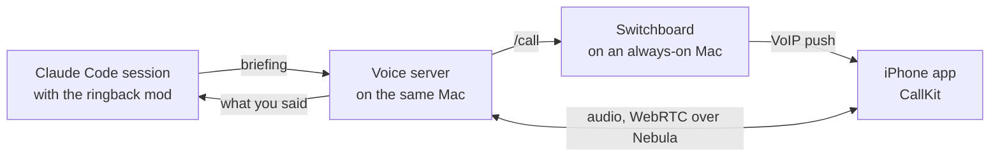

# ringback

**Your Claude Code sessions call you back.**

When a session finishes its work or needs a decision, your iPhone rings. You answer, a voice
tells you what the session did, and you talk it through hands-free: ask what changed, tell it
what to do next, approve the command it wants to run. What you say reaches the session, its
answer comes back to the call, and if you've hung up by then, it calls again.

Everything runs on your own Macs and phone, over your own [Nebula](https://github.com/slackhq/nebula)
network. The voice runs Claude Haiku through Claude Code on your Claude subscription, so there's
no API key and no cloud service of ours in between.

## What it does

- **Calls when a session is done.** Turn it on with `/ringback` in a session. Each time a turn
  finishes, the session writes a short spoken briefing and your phone rings through CallKit,
  locked or not, in your headphones.
- **Talks like a person.** You can interrupt the voice mid-sentence, and it stops. Speech is
  recognised and spoken on the Mac (Parakeet and Kokoro), and the voice answers one to two
  seconds after you stop speaking.
- **Acts on what you say.** Instructions and questions go to the session; the voice says it's
  passing them on, and tells you the answer when it comes. Ask for a better model and Opus
  takes over the call.
- **Answers prompts by voice.** A permission prompt or a question the session asks goes to the
  call. A clear yes or no, or your choice of its options, answers it in the terminal.
- **Keeps your hours.** Outside your work hours, or while you've paused calls with the hold
  switch, calls wait. They're listed in the app, a question gets one notification, and
  they ring when you take calls again. You can also answer a waiting question in the Claude
  app instead.
- **Works like the Phone app.** Recents is your call history: tap any call to call its session
  back. Sessions lists every session with ringback on, on every Mac, and tapping one calls it.
- **Holds up on a weak signal.** Opus at 24 kbps with forward error correction, and lost
  packets rebuilt or concealed on the Mac. Calls worked on 3G and on the Network Link
  Conditioner's Very Bad Network.

Each call's transcript is saved in the project, under `.ringback/calls/`, for the session to
read.

## How it works



- **The mod** (`mod/`) adds `/ringback` to Claude Code. While it's on, each finished turn has
  the session write a briefing, and the session's permission prompts and questions are offered
  to the call.
- **The voice server** (`voice/`) runs on each Mac with sessions. It places calls through the
  switchboard and runs the conversation with Pipecat: Silero to hear when you speak, Parakeet
  to recognise it, Haiku to answer, Kokoro to speak.
- **The switchboard** (`switchboard/`) is one small Swift binary on an always-on Mac. It keeps
  your phone's push token, rings it through Apple's push service, holds calls outside your work
  hours, and lists the sessions you can call.
- **The iPhone app** (`app/`) rings with CallKit and connects the audio to the calling Mac
  over Nebula, while it's still ringing, so the voice starts the moment you answer.

## Status

Ringback is a working prototype, built and tested in stages with one user and one phone.
"On the phone" means it worked on real calls; "offline" means it passed the scripted checks in
`tools/`, without a phone.

| | |
|---|---|
| A locked phone rings, and you talk with the voice | On the phone |
| Sessions call when they finish; what you say reaches them | On the phone |
| Permission prompts and questions answered on the call | On the phone |
| Opus on the line, missed calls called back, work hours | On the phone |
| Weak signal: 3G and Very Bad Network | On the phone |
| Recents and Sessions; calling a session or any past call | On the phone |
| The hold switch, in the app and in Control Center | Partly on the phone |
| Calls and questions that survive a restart of the voice server | Offline |
| A waiting question answered in the Claude app | Offline |
| Several sessions calling in turn, with retries | Planned |

The full plan, the decisions behind it and what each test showed are in
[docs/design.md](docs/design.md).

## Requirements

- A Mac with Apple silicon and Xcode for each Mac that runs sessions, with
  [XcodeGen](https://github.com/yonaskolb/XcodeGen) and [uv](https://github.com/astral-sh/uv)
- An always-on Mac for the switchboard (it needs nothing installed)
- A paid Apple Developer Program account, for VoIP pushes
- An iPhone on iOS 26 or later
- Nebula on the Macs and the iPhone, with a lighthouse that acts as a relay
- Claude Code on a Claude subscription that includes Opus

## Getting started

[docs/setup.md](docs/setup.md) walks through it in six steps: an APNs key, the iPhone app, the
switchboard, a voice server on each Mac, the mod, and a first test call. In short:

```sh
# The app: set your team and bundle ID in app/Config/Local.xcconfig, then
cd app && xcodegen generate

# The switchboard, built here and copied to the always-on Mac
cd switchboard && swift build -c release --arch arm64 --arch x86_64

# The voice server, on each Mac that runs sessions
cd voice && uv run ringback-voice serve --listen <nebula-ip>:8788 --switchboard <switchboard-ip>:8787

# In a Claude Code session
claude --plugin-dir path/to/ringback/mod
/ringback
```

## Repository

| Folder | What's in it |
|---|---|
| `app/` | The iPhone app (SwiftUI), with its Control Center and Lock Screen extension |
| `mod/` | The Claude Code mod (TypeScript) that adds `/ringback` |
| `switchboard/` | The switchboard (Swift, no dependencies) and its smoke test |
| `voice/` | The voice server (Python): calls, speech, and the link to each session |
| `tools/` | Checks and measurements behind the design, each with a README |
| `docs/` | The design and the setup guide |

## Development

Before every commit, these show that everything builds and passes its offline checks, in about
a minute:

```sh
(cd app && xcodegen generate && xcodebuild -project Ringback.xcodeproj -scheme Ringback \
  -destination 'generic/platform=iOS' -derivedDataPath build -allowProvisioningUpdates build)
(cd switchboard && swift build -c release --arch arm64 --arch x86_64 && ./smoke-test.sh)
(cd voice && uv run python -m compileall -q ringback_voice && uv run python -c 'import ringback_voice.__main__')
claude plugin validate mod && claude plugin test mod
```

They prove the code builds, not that calls work. To try a change to the conversation, play a
scripted call through the voice with `tools/call-check`; ringing, push and audio count only on
a real phone. `tools/` holds the rest: Nebula, speech recognition and speech speed, reply speed,
briefings, a session's calls and asks, the phone's side of a call, restarts, lost packets, and
the app's screens in a simulator.

## License

[MIT](LICENSE)
